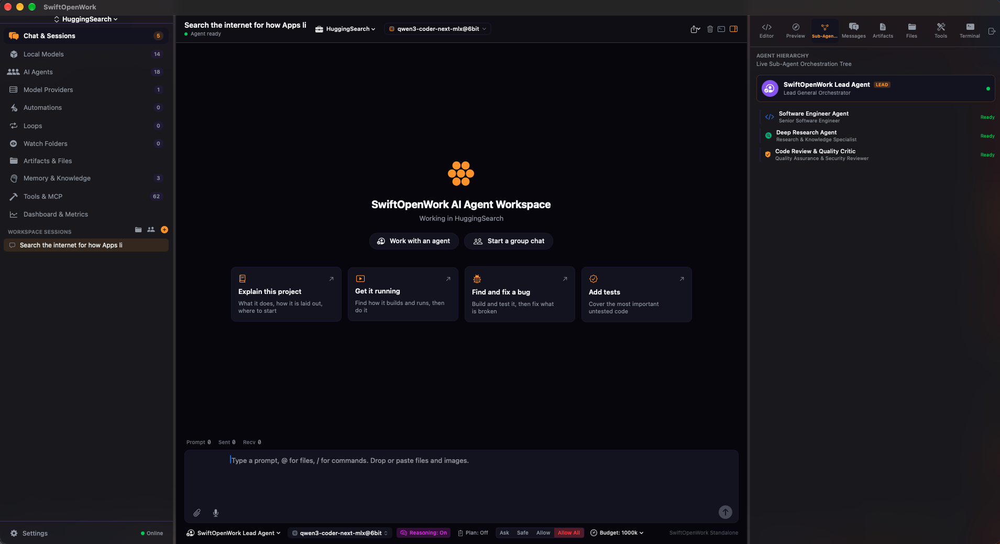

<p align="center">
  
</p>

<h1 align="center">SwiftOpenWork</h1>

<p align="center">
  <strong>Native macOS autonomous AI workbench</strong><br/>
  Swift · SwiftUI · Apple Silicon — no Electron
</p>

<p align="center">
  
  
  
  
  
</p>

<p align="center">
  <a href="#highlights">Highlights</a> ·
  <a href="docs/FEATURES.md">Features</a> ·
  <a href="#requirements">Requirements</a> ·
  <a href="#build--run">Build</a> ·
  <a href="docs/CONFIGURATION.md">Config</a> ·
  <a href="docs/DEVELOPMENT.md">Development</a> ·
  <a href="#privacy">Privacy</a>
</p>

---

## Overview

**SwiftOpenWork** is a standalone native macOS app for autonomous agents, multi-agent collaboration, scheduled automations, and local/cloud LLM orchestration.

It ships as a real `.app` — UI and tooling sit on system frameworks (`Accelerate`, `Vision`, `PDFKit`, `WebKit`, `Speech`, Keychain). End users who install a build do **not** need Xcode or Swift installed.

Agent tooling aims for **Radiant-class** reliability: official MCP Swift SDK sessions, namespaced first-class MCP tools, native function calling on local MLX and cloud providers, and a multi-turn tool loop that keeps going until the job is done (with sensible guards for local models).

<p align="center">
  
</p>

---

## Download

Get **`SwiftOpenWork.zip`** from the [latest release](https://github.com/Foscoe63/SwiftOpenWork/releases/latest), unzip it, and drag `SwiftOpenWork.app` to Applications. Releases are signed with a Developer ID and **notarised by Apple**, so the app opens with no Gatekeeper warning. The app checks for new releases itself.

Needs macOS 14 or later; Apple Silicon for the built-in local models. Accessibility and Screen Recording are only requested the first time the agent uses a tool that looks at the screen. Since those permissions follow the code signature, you grant them once, not on every update.

---

## Highlights

The short version. The full reference is in **[docs/FEATURES.md](docs/FEATURES.md)**.

- **Autonomous agents** — a multi-turn tool loop with native function calling (OpenAI, Anthropic, Ollama, in-process MLX): files, search, shell, build and test, git, web, documents, screenshots and live preview, with tool calls repaired rather than rejected
- **Code intelligence** — go to definition, find references, diagnostics and rename through real language servers (Swift, C/C++, TypeScript, Python, Rust, Go)
- **Sub-agents and group chats** — the lead delegates to sub-agents in their own worktrees; several agents can share one conversation
- **Control and review** — Ask / Safe / Allow / Allow All approvals, permission rules, hooks, an OS-level shell sandbox, token and spend budgets, inline diffs, per-turn undo and an audit log
- **Local first** — built-in Apple Silicon MLX engine with KV-cache reuse, plus Ollama, LM Studio, Splash, oMLX and any OpenAI-compatible or cloud provider. It can also serve the loaded model to other tools
- **External agents** — run Claude Code, Codex, Gemini CLI, OpenCode or Goose as chat agents over ACP
- **Automations and Loops** — scheduled, on-launch and folder-watch triggers, and self-verifying multi-step workflows
- **Editor and preview** — a built-in code editor with ghost-text suggestions, find in project, command palette and a live preview with console capture and click-to-pick
- **MCP** — Model Context Protocol client with cache-first discovery, hard deadlines, fail-closed read/write classification and per-tool switches; stock servers ship disabled. See [MCP servers](docs/FEATURES.md#mcp-servers)

---

## Requirements

| Use case | Need |
|---|---|
| **Run a built `.app`** | macOS 14+ (Sonoma or later); Apple Silicon recommended for MLX |
| **Build from source** | **Xcode 26.6+ (Swift 6.3)**, macOS 14+ SDK — `mlx-swift` declares `swift-tools-version: 6.3`, so the package graph will not resolve on an older toolchain whatever language mode this project's own modules use |
| **…and its Metal toolchain** | A separate download as of Xcode 26: `xcodebuild -downloadComponent MetalToolchain`. Without it `mlx-swift` fails at `CompileMetalFile` |
| **Optional local servers** | Ollama, LM Studio, oMLX / `mlx-lm`, or Osaurus — only if you use those backends |
| **Optional MacUse MCP** | [MacUse.app](https://macuse.app); Accessibility / Automation for write actions |
| **Optional GitHub CLI** | `brew install gh` then `gh auth login`, for `pr_status`, `pr_create` and the pull-request chip. This app never sees the token |
| **Optional external agents** | Claude Code, Codex, Gemini CLI, OpenCode or Goose, installed and signed in, to use them as chat agents over ACP |
| **Optional language servers** | Xcode provides `sourcekit-lsp`. For other languages: `clangd`, TypeScript 7+ (`npm install -D typescript`), `pyright`, `rust-analyzer`, `gopls`. For Xcode projects: `brew install xcode-build-server` |

Swift / Xcode are **not** required on machines that only install and run a prebuilt app.

---

## Build & run

```bash
brew install xcodegen   # once
xcodegen generate       # only when Sources/ changed
open SwiftOpenWork.xcodeproj
```

Select the **SwiftOpenWork** scheme and Run. Or from the command line, which points SwiftPM at the Xcode toolchain without changing anything global:

```bash
Scripts/swift.sh build
Scripts/swift.sh run SwiftOpenWork
Scripts/swift.sh test
```

Architecture, module layering, the test targets, installing a Debug build and notarizing a release are in **[docs/DEVELOPMENT.md](docs/DEVELOPMENT.md)**.

---

## Configuration

Providers (Settings → AI Providers, keys in the Keychain), local models, MCP servers, per-repo rules (`SWIFTOPENWORK.md` or `AGENTS.md` at the workspace root), agents and skills, safety level and budgets are all under Settings. The full list of where each setting lives is in **[docs/CONFIGURATION.md](docs/CONFIGURATION.md)**.

---

## Privacy

**Local first.** SwiftOpenWork talks only to LLM endpoints and MCP servers **you** configure. No bundled third-party analytics or telemetry.

- **A local turn never silently becomes a cloud one.** If the selected provider runs on this Mac and is switched off, the app substitutes another *local* provider or stops and says so. It never answers from whatever cloud endpoint happens to be enabled. A disabled *cloud* provider still falls back normally
- **The built-in provider is in-process MLX and nothing else.** It never probes for a local server to answer on its behalf, so a turn sent to it either ran here or failed with the reason
- **The local model API is off until you turn it on.** It listens on `127.0.0.1` only, needs a Keychain-stored key on every request, refuses browser `Origin` and non-loopback `Host`, and offers only local models unless you switch cloud models on
- **The audit log stays on this Mac**, with API keys, bearer tokens, passwords and private keys scrubbed before anything is written. An external agent (Claude Code, Codex…) talks to its own provider under its own sign-in; this app answers its permission requests and mediates the files it reads and writes, but does not see its network traffic
- **The agent can see what it built.** Screen Recording and Accessibility are asked for only when a perception tool is first used, and refusing them disables those tools and nothing else
- A project's own instructions, skills and hooks do not take effect until you have reviewed them

---

## License

MIT © 2026 SwiftOpenWork
